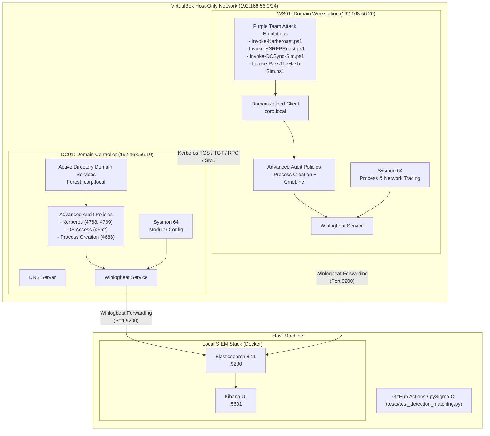

# Automated Active Directory Attack & Detection Range (Purple Teaming)

[](https://github.com/ravishkarathnayaka/Automated-Active-Directory-Attack-Detection-Range-Purple-Teaming-/actions/workflows/test-sigma-rules.yml)
[](https://github.com/ravishkarathnayaka/Automated-Active-Directory-Attack-Detection-Range-Purple-Teaming-/actions/workflows/security-scan.yml)
[](https://github.com/SigmaHQ/sigma)
[](https://attack.mitre.org/)
[](LICENSE)

An enterprise-grade, zero-cost, automated purple teaming pipeline designed to deploy an Active Directory lab environment, simulate sophisticated credential access attacks, ingest telemetry via tuned Sysmon and Windows Advanced Audit policies, and validate high-fidelity Sigma detection rules through automated CI testing.

---

## Table of Contents
- [Architecture Overview](#architecture-overview)
- [MITRE ATT&CK Matrix Mapping](#mitre-attck-matrix-mapping)
- [Repository Structure](#repository-structure)
- [Prerequisites & System Requirements](#prerequisites--system-requirements)
- [Deployment & Setup Guide](#deployment--setup-guide)
  - [1. Launch Local SIEM Stack](#1-launch-local-siem-stack-docker)
  - [2. Deploy Active Directory Lab](#2-deploy-active-directory-lab-vagrant)
  - [3. Verify Telemetry Pipeline](#3-verify-telemetry-pipeline)
- [Purple Team Attack Emulation Suite](#purple-team-attack-emulation-suite)
  - [Phase 1: Kerberoasting (T1558.003)](#phase-1-kerberoasting-t1558003)
  - [Phase 2: AS-REP Roasting (T1558.004)](#phase-2-as-rep-roasting-t1558004)
  - [Phase 3: DCSync Simulation (T1003.006)](#phase-3-dcsync-simulation-t1003006)
  - [Phase 4: Pass the Hash Simulation (T1550.002)](#phase-4-pass-the-hash-simulation-t1550002)
- [Sample Telemetry & Sigma Rule Correlation](#sample-telemetry--sigma-rule-correlation)
- [Continuous Integration & Rule Testing](#continuous-integration--rule-testing)
- [Detection Remediation & Hardening](#detection-remediation--hardening)
- [License & Ethical Use](#license--ethical-use)

---

## Architecture Overview

The lab deploys an isolated host-only network (`192.168.56.0/24`) containing a Windows Server 2019 Domain Controller (`DC01`) and a Windows 10 Enterprise Domain Workstation (`WS01`). Both endpoints run Microsoft Sysmon and Winlogbeat to forward events directly to an Elastic SIEM stack running on the virtualization host.



---

## MITRE ATT&CK Matrix Mapping

| Phase | MITRE Tactic | Technique ID | Technique Name | Windows / Sysmon Telemetry | High-Fidelity Sigma Rule | Severity |
| :--- | :--- | :--- | :--- | :--- | :--- | :--- |
| **Phase 1** | Credential Access | **T1558.003** | Steal or Forge Kerberos Tickets: Kerberoasting | Security **4769** (TicketEncryptionType `0x17`) | [`win_ad_kerberoasting_spn_request.yml`](detections/sigma/win_ad_kerberoasting_spn_request.yml) | `High` |
| **Phase 2** | Credential Access | **T1558.004** | Steal or Forge Kerberos Tickets: AS-REP Roasting | Security **4768** (PreAuthType `0`, Status `0x0`) | [`win_ad_asrep_roasting_preauth.yml`](detections/sigma/win_ad_asrep_roasting_preauth.yml) | `High` |
| **Phase 3** | Credential Access | **T1003.006** | OS Credential Dumping: DCSync | Security **4662** (Access Mask `0x100`, DRSUAPI GUIDs) | [`win_ad_dcsync_replication_access.yml`](detections/sigma/win_ad_dcsync_replication_access.yml) | `Critical` |
| **Phase 4** | Lateral Movement | **T1550.002** | Use Alternate Authentication Material: Pass the Hash | Security **4624** (Logon Type 3/9, NTLM) | [`win_susp_powershell_encoded_cmd.yml`](detections/sigma/win_susp_powershell_encoded_cmd.yml) | `Medium` |
| **Phase 5** | Execution / Defense Evasion | **T1059.001**, **T1027** | PowerShell Obfuscated / Encoded Command Execution | Sysmon **1** / Security **4688** (EncodedCommand, Hidden) | [`win_susp_powershell_encoded_cmd.yml`](detections/sigma/win_susp_powershell_encoded_cmd.yml) | `Medium` |

---

## Repository Structure

```
├── .github/
│   └── workflows/
│       ├── test-sigma-rules.yml          # Automated CI: Validates Sigma syntax & test events via pySigma
│       └── security-scan.yml             # Automated CI: Secret scanner using Gitleaks
├── vagrant/
│   ├── Vagrantfile                       # Multi-VM Vagrant definition (DC01 & WS01)
│   └── scripts/
│       ├── provision_dc.ps1              # Forest deployment, AD DS role install, DNS config
│       ├── populate_domain.ps1           # OUs, users, groups, and roastable accounts (SPNs & PreAuth disabled)
│       ├── provision_workstation.ps1     # Configures networking and joins WS01 to corp.local
│       └── install_telemetry.ps1         # Installs Sysmon, audit policies, Winlogbeat, and logging keys
├── telemetry/
│   ├── sysmonconfig.xml                  # Modular Sysmon configuration tuned for AD credential abuse
│   ├── auditpol_commands.bat             # Advanced Audit Policy commands enabling 4768, 4769, 4662, 4688
│   └── winlogbeat.yml                    # Winlogbeat configuration forwarding logs to local Elastic SIEM
├── attacks/
│   ├── Invoke-Kerberoast.ps1             # Pure PowerShell Kerberoasting simulation (T1558.003)
│   ├── Invoke-ASREPRoast.ps1             # Queries DONT_REQ_PREAUTH accounts & sends AS-REQ (T1558.004)
│   ├── Invoke-DCSync-Sim.ps1             # Simulates DRSUAPI replication requests via LDAP DirSync (T1003.006)
│   ├── Invoke-PassTheHash-Sim.ps1        # Simulates NTLM session token authentication (T1550.002)
│   └── run_purple_team.ps1               # Master orchestration script with timestamps and scorecard
├── detections/
│   ├── sigma/
│   │   ├── win_ad_kerberoasting_spn_request.yml
│   │   ├── win_ad_asrep_roasting_preauth.yml
│   │   ├── win_ad_dcsync_replication_access.yml
│   │   └── win_susp_powershell_encoded_cmd.yml
│   └── test_events/
│       ├── event_kerberoast.json          # Synthetic Event 4769 payload for regression testing
│       ├── event_asrep.json               # Synthetic Event 4768 payload for regression testing
│       ├── event_dcsync.json              # Synthetic Event 4662 payload for regression testing
│       └── event_powershell_encoded.json  # Synthetic Sysmon Event 1 payload for regression testing
├── docker/
│   ├── docker-compose.yml                 # Local Elasticsearch 8.11 & Kibana stack
│   └── .env.example                       # Port and authentication environment configurations
├── tests/
│   ├── test_sigma_syntax.py               # pySigma specification and syntax validator
│   └── test_detection_matching.py         # Pytest harness verifying rule matching on test events
└── README.md                              # Comprehensive architecture, attack guide, and documentation
```

---

## Prerequisites & System Requirements

- **Virtualization**: [VirtualBox](https://www.virtualbox.org/) (>= 7.0)
- **Infrastructure Automation**: [Vagrant](https://developer.hashicorp.com/vagrant/downloads) (>= 2.3)
- **Containerization**: [Docker & Docker Compose](https://docs.docker.com/get-docker/) (for local SIEM)
- **Host Specs**:
  - Minimum 16 GB RAM (allocates 4 GB to DC01, 3 GB to WS01, 2 GB to Docker SIEM)
  - 80 GB free disk space (SSD recommended)
- **Testing Dependencies**: Python 3.10+ (`pip install pySigma pySigma-backend-elasticsearch pytest pyyaml`)

---

## Deployment & Setup Guide

### 1. Launch Local SIEM Stack (Docker)

Before spinning up the virtual machines, launch Elasticsearch and Kibana to receive logs:

```bash
cd docker
cp .env.example .env
docker compose up -d
```

Verify service availability:
- **Elasticsearch**: [http://localhost:9200](http://localhost:9200) (Credentials: `elastic` / `Changeme123!`)
- **Kibana Dashboard**: [http://localhost:5601](http://localhost:5601)

### 2. Deploy Active Directory Lab (Vagrant)

Bring up both virtual machines in sequence:

```bash
cd vagrant

# Step 2a: Spin up and provision Domain Controller (DC01)
vagrant up DC01

# Step 2b: Spin up and join Workstation (WS01) to domain corp.local
vagrant up WS01
```

*Note: Provisioning automatically executes:*
- AD DS forest installation (`corp.local`)
- Domain structure generation with vulnerable targets (`svc_sqlserver`, `usr_roastable`, `svc_replication`)
- Sysmon installation with `sysmonconfig.xml`
- Advanced Audit Policy configuration via `auditpol_commands.bat`
- Winlogbeat log shipper startup pointing to `http://192.168.56.1:9200`

### 3. Verify Telemetry Pipeline

Log in to Kibana at [http://localhost:5601](http://localhost:5601), navigate to **Analytics > Discover**, and create a data view matching `winlogbeat-*`. You should observe incoming logs from both `DC01.corp.local` and `WS01.corp.local`.

---

## Purple Team Attack Emulation Suite

Open a PowerShell terminal on `WS01` or run via WinRM to execute the automated suite.

### Master Automated Runner

To run all attack vectors sequentially with log stream pause markers:

```powershell
powershell.exe -ExecutionPolicy Bypass -File C:\vagrant\attacks\run_purple_team.ps1
```

Output:
```plaintext
================================================================================
   AUTOMATED ACTIVE DIRECTORY PURPLE TEAM ATTACK & DETECTION SUITE              
================================================================================
>>> [PHASE 1 / 4] EXECUTING KERBEROASTING ATTACK EMULATION
    [+] Discovered 1 potential Kerberoastable target(s):
        -> Target: svc_sqlserver | SPNs: MSSQLSvc/db01.corp.local:1433
    [SUCCESS] Ticket received successfully!
    [INFO] Security Event: Windows Security Event ID 4769 emitted on Domain Controller

>>> [PHASE 2 / 4] EXECUTING AS-REP ROASTING ATTACK EMULATION
    [+] Found 1 AS-REP roastable account(s): usr_roastable
    [SUCCESS] AS-REP response received with encrypted credential data!
    [INFO] Generated Telemetry: Event ID 4768 (Audit Success) logged on DC

>>> [PHASE 3 / 4] EXECUTING DCSYNC REPLICATION EMULATION
    [+] Constructed Directory Synchronization Request Control (OID 1.2.840.113556.1.4.841)
    [SUCCESS] Directory replication query processed by Domain Controller!
    [INFO] Generated Telemetry: Windows Security Event ID 4662 logged on DC

>>> [PHASE 4 / 4] EXECUTING PASS THE HASH SIMULATION
    [SUCCESS] Token created and authenticated to target!
    [INFO] Authentication Package: NTLM V2
================================================================================
                      PURPLE TEAM EMULATION SCORECARD                           
================================================================================
Phase                 MITRE_ID  ExpectedEventID          SigmaRule                                Status  ExecutionTime
-----                 --------  ---------------          ---------                                ------  -------------
1. Kerberoasting      T1558.003 Security 4769 (0x17)     win_ad_kerberoasting_spn_request.yml     SUCCESS 2s           
2. AS-REP Roasting    T1558.004 Security 4768 (PreAuth 0) win_ad_asrep_roasting_preauth.yml       SUCCESS 1s           
3. DCSync Simulation  T1003.006 Security 4662 (0x100)    win_ad_dcsync_replication_access.yml    SUCCESS 2s           
4. Pass the Hash      T1550.002 Security 4624 / Sysmon 1 win_susp_powershell_encoded_cmd.yml      SUCCESS 1s           
```

---

## Sample Telemetry & Sigma Rule Correlation

### 1. Kerberoasting (Event ID 4769)
#### Raw Windows Event Log:
```json
{
  "EventID": 4769,
  "Channel": "Security",
  "TargetUserName": "svc_sqlserver@corp.local",
  "ServiceName": "MSSQLSvc/db01.corp.local:1433",
  "TicketOptions": "0x40810000",
  "TicketEncryptionType": "0x17",
  "Status": "0x0",
  "IpAddress": "::ffff:192.168.56.20"
}
```
#### Matching Sigma Rule: [`win_ad_kerberoasting_spn_request.yml`](detections/sigma/win_ad_kerberoasting_spn_request.yml)
```yaml
detection:
  selection:
    EventID: 4769
    TicketEncryptionType: '0x17'
    Status: '0x0'
  filter_machine_accounts:
    ServiceName|endswith: '$'
  condition: selection and not filter_machine_accounts
```

---

### 2. AS-REP Roasting (Event ID 4768)
#### Raw Windows Event Log:
```json
{
  "EventID": 4768,
  "Channel": "Security",
  "TargetUserName": "usr_roastable",
  "TargetDomainName": "CORP",
  "PreAuthType": "0",
  "TicketEncryptionType": "0x17",
  "Status": "0x0",
  "IpAddress": "::ffff:192.168.56.20"
}
```
#### Matching Sigma Rule: [`win_ad_asrep_roasting_preauth.yml`](detections/sigma/win_ad_asrep_roasting_preauth.yml)
```yaml
detection:
  selection:
    EventID: 4768
    PreAuthType: '0'
    Status: '0x0'
  filter_machine_accounts:
    TargetUserName|endswith: '$'
  condition: selection and not filter_machine_accounts
```

---

### 3. DCSync Replication (Event ID 4662)
#### Raw Windows Event Log:
```json
{
  "EventID": 4662,
  "Channel": "Security",
  "SubjectUserName": "svc_replication",
  "SubjectDomainName": "CORP",
  "AccessMask": "0x100",
  "Properties": "Control Access\n\t\t{1131f6ad-9c07-11d1-f79f-00c04fc2dcd2}\n\t\t{1919524d-98e9-11d1-93c4-00c04fd8d5b8}"
}
```
#### Matching Sigma Rule: [`win_ad_dcsync_replication_access.yml`](detections/sigma/win_ad_dcsync_replication_access.yml)
```yaml
detection:
  selection:
    EventID: 4662
    AccessMask: '0x100'
  drsuapi_guids:
    Properties|contains:
      - '1131f6aa-9c07-11d1-f79f-00c04fc2dcd2'
      - '1131f6ad-9c07-11d1-f79f-00c04fc2dcd2'
      - '89e4b325-9be7-11d1-b8c0-00c04fc2dcd2'
  filter_machine_accounts:
    SubjectUserName|endswith: '$'
  condition: selection and drsuapi_guids and not filter_machine_accounts
```

---

## Continuous Integration & Rule Testing

This project incorporates automated CI using GitHub Actions and `pySigma` to enforce detection engineering standards:
- **Syntax & Schema Validation**: Verifies all rules comply with the Sigma specification.
- **Detection Matching Harness**: Executes mock JSON payloads against Sigma detection blocks to prevent regressions.

Run the test suite locally:

```bash
# Install dependencies
pip install pySigma pySigma-backend-elasticsearch pytest pyyaml

# Execute pytest suite
python -m pytest tests/ -v
```

Expected output:
```
tests/test_detection_matching.py::TestKerberoastDetection::test_kerberoast_event_matches PASSED
tests/test_detection_matching.py::TestASREPRoastDetection::test_asrep_event_matches PASSED
tests/test_detection_matching.py::TestDCSyncDetection::test_dcsync_event_matches PASSED
tests/test_detection_matching.py::TestSuspiciousPowerShellDetection::test_powershell_encoded_event_matches PASSED
tests/test_sigma_syntax.py::test_sigma_rule_pysigma_parsing PASSED
============================== 20 passed in 0.26s ==============================
```

---

## Detection Remediation & Hardening

| Attack Vector | Hardening / Remediation Recommendation |
| :--- | :--- |
| **Kerberoasting** | Transition service accounts to **Group Managed Service Accounts (gMSA)** with 128-character automatically rotated passwords; enforce AES-128/AES-256 Kerberos encryption types and disable RC4-HMAC. |
| **AS-REP Roasting** | Enforce Kerberos Pre-Authentication on all user and service accounts by clearing the `DONT_REQ_PREAUTH` bit in `userAccountControl`. |
| **DCSync** | Restrict `DS-Replication-Get-Changes` and `DS-Replication-Get-Changes-All` extended rights strictly to Domain Controllers (`Domain Controllers` group) and Tier-0 Administrative accounts. |
| **PowerShell Obfuscation** | Enable Windows Defender Application Control (WDAC) in **Constrained Language Mode (CLM)**; enforce Script Block Logging (Event 4104) and Transcription. |

---

## License & Ethical Use

This project is licensed under the [MIT License](LICENSE).

> **DISCLAIMER**: The attack simulation scripts and configurations provided in this repository are designed strictly for authorized cybersecurity research, education, purple teaming, and detection engineering validation. Running these simulations against networks or directory services without explicit, written authorization is illegal.
